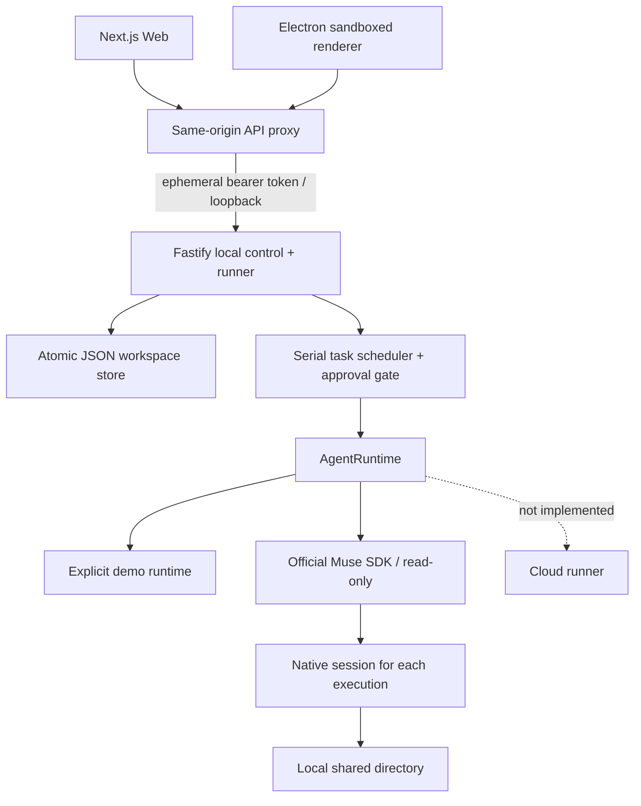

# Architecture / Phase 1



Single-user local MVP. No central account, service or model key is required for the demo. Data paths are controlled by startup environment, never browser input. State writes are serialized within one API process, cloned before mutation and committed by atomic rename. No cross-process writer lock or database: one process per data directory is a hard deployment limit. No power-loss/fsync guarantee.

## Collaboration protocol

A group contains an ordered list of Bot IDs. Bot names are unique and mention-safe. Exact `@name` tokens select group members; absent mentions select the first member. User messages create root tasks. A task carries `groupId`, `botId`, `sessionId`, optional `parentId`, status, result or error. A completed task can be handed to another group member, with parent output inserted into the recipient's context.

Real model replies may be plain text, or this entire JSON object (no Markdown fence):

```json
{
  "text": "需求已整理，交给测试员审查",
  "delegations": [
    { "botId": "existing-group-member-id", "title": "审查实现成果" }
  ]
}
```

The server validates the schema and membership. Max three children per model reply, three edges deep, eight tasks total per root, no repeated Bot/title pair within a chain. Invalid delegation becomes a visible blocked event. Model-authored messages cannot decide approvals. There is no free-running Bot-to-Bot response loop. Explicit @ targeting is task assignment; human handoff works with the demo, while model-planned delegation is tested using a deterministic runtime substitute.

Muse tasks start as `awaiting_approval`. The user decides once; approval only transitions that task to `pending`. When a Muse Bot receives a handoff it requires a new approval. The worker executes pending tasks serially. Each execution starts a fresh SDK host and native session with shared directory as workspace root. The app's session UUID is a logical execution handle, not a resumable MSP session ID. SDK hosts are closed on success/failure. Responses stream into persisted messages and the browser polls every 750 ms. This is incremental display over polling, not an SSE/WebSocket transport.

On API restart, active, queued and approval-waiting tasks become failed; pending approvals become denied. There is no automatic replay of potentially side-effecting work.

## Shared VM target (not delivered)

The invariant is **one workspace owns one persistent computer; each Bot has an isolated operation session**. A future `Computer` resource will own the persistent disk and lifecycle, and a `ComputerSession` will own each Bot's display/browser context and tool lease. Runtimes resolve workspace computer IDs rather than provisioning per-Bot VMs.

Phase 2 must implement actual local VM provisioning, independent displays/input channels, workspace filesystem permissions, explicit shared browser-state grants, resource locks, read-only screenshots, user takeover and audit. Phase 3 provides a cloud implementation of that same boundary, remote viewing and migration. Different users/workspaces must have separate VM and credentials; a shared gateway is not a multi-tenant security boundary.

The current Local Runner runs on the host with Muse's own enforced read-only permission posture. Distinct native sessions provide conversation separation, **not OS isolation**. There is no shared VM, live display, browser driver, file-write executor, distributed scheduler, or cloud provisioner in this release.

## Deliberate simplifications

The target planning tree is not generated as empty packages. `apps/api` owns the local runner for this phase; native runtime core and Muse adapter live in `packages/runtime`. PostgreSQL, Redis, BullMQ, OpenClaw adapters and other model providers will be added when required by working features. This keeps the runnable core inspectable and avoids pretending placeholder services are implemented.
